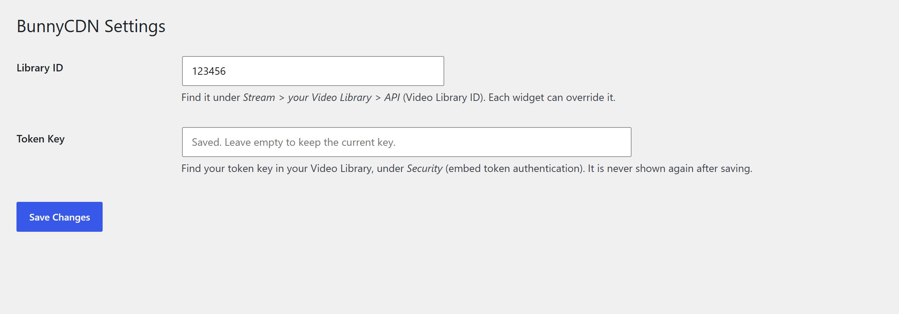
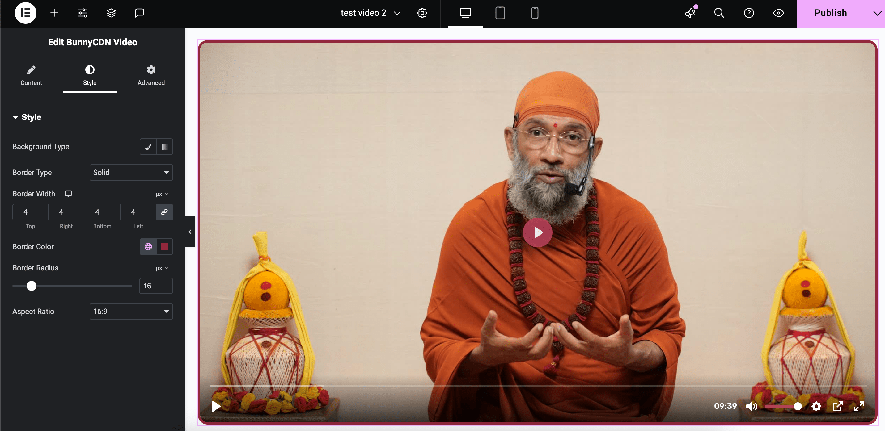

# BunnyCDN Video Widget for Elementor

An Elementor widget that embeds [Bunny Stream](https://bunny.net/stream/) videos with **signed, expiring URLs**. Each page view gets a fresh token, so a copied embed link stops working once it expires. I built it for a membership LMS (LearnDash + BuddyBoss) where paid lessons had to stay inside the platform.


## Features

- Embed any Bunny Stream video by its Video ID
- Token authentication: `sha256(token key + video ID + expires)`, generated server-side on every render
- Configurable token lifetime per widget (default 180 minutes)
- Library ID set once in **Settings > BunnyCDN**, with an optional per-widget override
- Autoplay, muted, loop and preload options
- Responsive player with 16:9, 4:3 and 1:1 aspect ratios
- Elementor style controls: background, border and per-corner radius
- The token key is never printed back in the admin, and visitors never see setup errors

## Requirements

- WordPress 5.0+ and PHP 7.2+
- [Elementor](https://wordpress.org/plugins/elementor/) (free is enough)
- A Bunny Stream video library with **embed token authentication** enabled

## Installation

1. Download `bunnycdn-elementor-widget.zip` from the [latest release](../../releases/latest).
2. In WordPress, go to **Plugins > Add New > Upload Plugin**, upload the zip and activate it.
3. Open **Settings > BunnyCDN** and enter:
   - **Library ID**: on your video library's API page in the Bunny dashboard
   - **Token Key**: in the library's Security settings (embed token authentication)
4. In Elementor, search for **BunnyCDN Video**, drop it on the page and paste a Video ID.



## How it works

On render, the widget builds the embed URL:

```
https://iframe.mediadelivery.net/embed/{library_id}/{video_id}?token={sha256(key . video_id . expires)}&expires={unix_time}
```

Bunny validates the token and the expiry before serving the video. The key only lives in the WordPress options table and is never sent to the browser.

> Pages cached by a full-page cache keep the token they were rendered with. Set the cache lifetime of pages with protected videos below the token expiration, or exclude them from the cache.



## Upgrading from 1.5x

Earlier versions had the Library ID hard-coded. After updating to 1.6.0, enter it under **Settings > BunnyCDN**, or videos will show a setup notice to editors instead of the player.

## Changelog

See the Changelog section in [readme.txt](readme.txt).

## License

[GPL-2.0-or-later](LICENSE) © Gabriel Mafra
